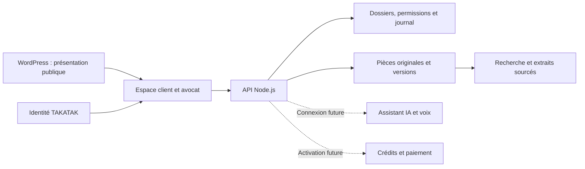

# Espace client et avocat — décision du 26 octobre 2026

Le propriétaire a demandé de construire une application de travail pour ses dossiers, puis pour d'autres clients. Il a confirmé **besoinavocat.ca** et **MochaHost**. L'adresse de compte souhaitée est connue de l'exploitant; aucune adresse personnelle ni pièce réelle n'est nécessaire dans ce dépôt public.

## Parcours cible

WordPress conserve ses pages et son administration. Le portail est une application distincte. Un lien « Mon dossier » reliera les deux après vérification du serveur et de l'URL HTTPS. Un thème ou une extension PHP ne se convertit pas automatiquement en code Node.js. Les éventuels contenus à reprendre devront être inventoriés depuis l'administration WordPress.

## Premier socle local

Le dossier `platform/` contient le pilote. Il est séparé du site d'orientation publié depuis `site/` sur Render. La vitrine WordPress de besoinavocat.ca et ce site Render sont deux installations différentes.

- API Node.js 24 avec stockage SQLite persistant et fichiers hors de la racine publique. Ce choix sert à éprouver un pilote sur une instance; il ne constitue pas une architecture multi-serveurs validée.
- Identité TAKATAK obligatoire pour l'API privée. Aucun mot de passe local, compte de secours ou connexion par simple adresse courriel.
- Permissions par organisation et par dossier, contrôlées sur chaque accès.
- Original conservé par empreinte SHA-256, lien entre versions, provenance et statut de contrôle explicites. Le texte saisi ou extrait n'acquiert pas le statut de pièce vérifiée.
- Recherche dans les métadonnées et textes disponibles. Absence de résultat ne signifie pas absence de preuve.
- Échanges dans le dossier; durée de travail déclarée et soumise à validation. Le temps de frappe et l'ouverture d'un fichier ne créent pas d'honoraires.
- Aucun calcul automatique de pertes à partir des fichiers dupliqués; pas de total comptable dans le pilote.

## Raccordement à TAKATAK

L'examen du dépôt TAKATAK au commit `4e57ccf6a3623548081067263341039aef2fc498` a trouvé Supabase Auth, des profils et des appartenances, mais **aucun contrat d'authentification BesoinAvocat prêt à utiliser**. Le contexte d'identité existant ne prouve pas à lui seul une autorisation sur ce produit ou ce dossier. Les services particuliers à 1LV et le JWKS Bluesky ne doivent pas être réutilisés comme une connexion générique.

L'adaptateur local décrit un contrat proposé de vérification de jeton côté serveur. Il reste désactivé jusqu'à l'existence d'un service dédié et vérifié : identité stable, organisation, produit BesoinAvocat, statut actif, expiration/révocation et habilitations explicites. Le flux de connexion navigateur et l'échange de session restent à implémenter contre ce contrat réel. L'aperçu fictif n'est jamais une session client.

## Pièces et import

Le dossier maître OneDrive est la source de préparation. Le paquet historique de 312 annexes reste une version distincte et immuable. L'outil de préparation d'import génère un inventaire local avec empreintes et provenance; il n'envoie pas les fichiers. Le futur import devra rapprocher les versions et les cotes, et prouver les empreintes avant et après transfert.

Les originaux, déclarations et analyses restent attribués. Un doublon n'est pas une deuxième dépense. Une extraction OCR nécessite un contrôle sur l'original. Les pièces contraires et les vérifications ouvertes sont conservées.

## Modules suivants

| Module | Travail restant avant activation |
|---|---|
| IA documentaire | Modèle et budget choisis, recherche limitée au dossier autorisé, citations page/pièce, journal d'utilisation, traitement des instructions malveillantes dans les documents, tests d'absence de réponse inventée. |
| Voix / Twilio | Compte et numéro autorisés, parcours appelant, information sur l'enregistrement, portée des actions, signatures des événements, coûts et limites. |
| Crédits clients | Unité et tarif définis, registre comptable immuable, réservation/débit/remboursement, événements de paiement signés et idempotents, tests avant encaissement. |
| Collaboration avocat | Invitations et consentements, identité professionnelle vérifiée selon le parcours retenu, permissions révocables, notifications choisies. |
| Accès aux fichiers locaux | Choix volontaire d'un fichier ou d'un dossier limité, aperçu et validation du transfert. Aucun contrôle permanent du disque ni accès distant implicite. |
| Production | Hébergement confirmé, sauvegarde/restauration éprouvée, capacité de stockage, HTTPS, supervision, protection des téléversements, contrat d'identité réel et parcours complet testé. |

## Références techniques consultées

- [API WordPress](https://developer.wordpress.org/rest-api/) : raccordement d'une application externe.
- [SQLite de Node.js](https://nodejs.org/api/sqlite.html) : stockage local et requêtes préparées; version du pilote fixée dans ses exigences.
- [Changements Supabase Auth](https://supabase.com/changelog?tags=auth) : vérifiés le 26 octobre; TLS ancien à retirer en novembre et modification d'URL SAML des installations auto-hébergées à considérer lors d'un futur raccordement. Aucun schéma ou service Supabase n'a été modifié.
- [Déploiement Node.js avec cPanel](https://docs.cpanel.net/knowledge-base/web-services/how-to-install-a-node.js-application/) : les possibilités dépendent des composants et versions installés par l'hébergeur.
