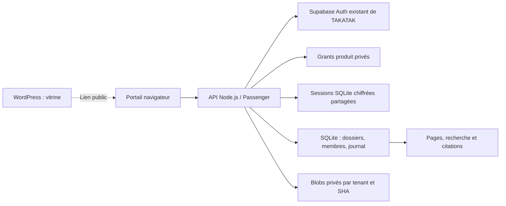

# Espace client et avocat — architecture au 26 octobre 2026

**WordPress est la vitrine; Node.js porte le travail documentaire privé.** Le code de la nouvelle plateforme est validé localement. Le portail initial est créé sur MochaHost, mais sa mise à jour est bloquée par un refus antivirus du paquet cPanel. L'authentification et le corpus décrits ci-dessous ne sont donc pas présentés comme opérationnels à distance. Voir les preuves et limites dans [PLATFORM_QA.md](PLATFORM_QA.md).

## Installations distinctes

| Installation | Fonction |
|---|---|
| `besoinavocat.ca` — WordPress chez MochaHost | Présentation publique, contenus et aperçu du parcours. Aucune identité ou base documentaire privée parallèle dans WordPress. |
| `portail.besoinavocat.ca` — Node.js / Passenger chez MochaHost | Backend et interface du portail. HTTPS et démarrage initial confirmés sous Node 24.22.1; mise à jour finale non installée. |
| `besoinavocat.onrender.com` — site statique issu de `site/` | Parcours d'orientation indépendant. Il ne remplace pas WordPress et ne reçoit pas son DNS. |

WordPress conserve ses URL et son administration. Un lien vers le portail ne doit pas annoncer un accès documentaire fonctionnel avant la vérification du parcours connecté. L'aperçu fictif reste distinct d'une session client.

## Architecture implémentée dans le code

Ce schéma décrit le code, sans certifier son installation finale. Les bases et fichiers privés sont hors de l'application et des racines web. Le serveur ne sert qu'une liste explicite de ressources publiques; les téléchargements documentaires passent par une route authentifiée avec contrôle du tenant et du dossier.

SQLite utilise le stockage local de l'hôte. Les transactions protègent les écritures concurrentes; les sessions et limites d'authentification sont partagées entre les workers Passenger. **Aucune affinité de session vers un worker unique n'est requise.** Cette adaptation ne valide pas SQLite sur NFS, plusieurs hôtes ou une charge de production non mesurée. Les détails du lanceur CommonJS/ESM, des chemins et du paquet à liste blanche figurent dans [CPANEL_NODE.md](CPANEL_NODE.md).

## Identité existante et autorisations locales

Le flux navigateur réutilise **Supabase Auth, fournisseur existant de TAKATAK** : connexion par `/auth/v1/token?grant_type=password`, puis vérification serveur par `/auth/v1/user`. Cette vérification est répétée à chaque résolution de session. Aucun mot de passe local, compte WordPress ou utilisateur TAKATAK de remplacement n'est créé. Le mot de passe n'est pas conservé; le refresh token reçu est écarté.

L'identité vérifiée n'autorise pas à elle seule l'accès au produit. Un fichier privé de grants associe explicitement un subject stable à un tenant BesoinAvocat actif; il est relu à chaque connexion et résolution. Ni l'adresse courriel ni des métadonnées modifiables par l'utilisateur ne donnent de rôle. Ce module ne vérifie pas le statut métier de tous les profils TAKATAK. L'ancienne introspection Bearer reste un mécanisme distinct; elle n'est pas artificiellement raccordée à `identity-context`, dont le contrat diffère.

Les appartenances aux dossiers sont gérées côté serveur. La création d'un dossier donne le rôle **client**, jamais propriétaire par simple authentification. Clients, avocats et propriétaires restent limités à leurs dossiers. Seuls les rôles autorisés peuvent valider le temps d'une autre personne; l'autoapprobation est refusée. Il n'existe pas d'endpoint public attribuant des rôles.

## Sessions partagées et protections HTTP

Le navigateur reçoit seulement un cookie opaque aléatoire `__Host-ba_session`, `HttpOnly`, `Secure`, `SameSite=Strict`, `Path=/`. Sa durée est bornée par l'échéance du fournisseur et une heure. Cookie et Bearer simultanés, cookies ambigus et configuration invalide sont refusés.

En production, une base SQLite privée distincte conserve l'empreinte du cookie et un payload **AES-256-GCM** contenant le jeton d'accès et l'identité. La clé binaire de 32 octets reste dans un fichier privé séparé, jamais dans Git ou une variable affichée. Les origines, l'échéance et la révision de session sont liées cryptographiquement au payload. La paire base/clé est obligatoire en production; le mode mémoire est réservé au développement et aux tests.

La déconnexion supprime cette session partagée. Une nouvelle vérification SQL après les appels asynchrones empêche qu'une réponse fournisseur tardive annule cette déconnexion. Fermer un worker ne supprime pas les sessions des autres. Les limites de tentatives, de sessions et de concurrence sont partagées via des transactions. Le compte fournisseur n'est pas déconnecté globalement : un jeton déjà émis peut rester valide chez Supabase jusqu'à son échéance.

Connexion, déconnexion et mutations utilisant le cookie exigent l'origine HTTPS exacte et `X-Requested-With: XMLHttpRequest`. Réponses privées sans cache, bornes JSON, délais et tailles des réponses fournisseur, refus des redirections et erreurs publiques génériques complètent ces contrôles. Le contrat et les limites figurent dans [BROWSER_AUTH.md](BROWSER_AUTH.md).

## Documents, versions et lecture

- Les octets originaux sont conservés par tenant et SHA-256. Les versions et occurrences restent des enregistrements distincts; le partage des mêmes octets n'efface pas leur provenance.
- Tenant et appartenance sont contrôlés pour les métadonnées, pages, recherches, téléchargements, échanges, temps et journal. Les actions pertinentes sont journalisées.
- Les pages importées conservent texte, ordinal, numéro disponible, méthode d'extraction et métadonnées de provenance. Les citations relient l'extrait à la pièce et à son empreinte. Un résultat trouvé uniquement par nom ou référence n'invente pas de citation de page.
- Le lecteur affiche du texte échappé, distinct du fichier original. Les déclarations, analyses et OCR gardent leur attribution et leurs réserves. L'import ne transforme pas une extraction en pièce vérifiée.
- Recherche, quotas et limites de fichier sont bornés. L'absence de résultat ne prouve pas l'absence de document. Les limites opérationnelles de charge et l'analyse antivirus des nouveaux téléversements restent à valider.
- Aucun total de pertes ne découle des doublons. Les durées déclarées et validées restent séparées; ouvrir un fichier ou taper du texte ne crée pas d'honoraires.

## Préparation, import et restauration

Le maître OneDrive demeure la source de préparation. Le paquet historique de **312 annexes** reste distinct et immuable. L'outil de préparation produit par défaut un manifeste local sans transfert. L'outil d'exécution est une commande d'exploitation explicite, sans route HTTP : destination, plan, corpus et fichiers doivent passer leurs contrôles SHA, de chemin, d'accès et de quota. Les imports répétés sont idempotents dans leur périmètre. Aucun import ne modifie les sources ni n'additionne les occurrences.

L'import privé local et la sauvegarde/restauration ont été contrôlés : **3 dossiers, 1 359 occurrences documentaires, 3 098 pages ou unités et 1 182 blobs uniques dans le tenant**. Ces chiffres ne qualifient pas les dossiers d'exhaustifs. Leurs noms, les identités et les données restent hors du dépôt public.

L'[outil de sauvegarde](../platform/tools/backup-corpus.py) utilise un snapshot SQLite cohérent avec WAL et collecte les blobs référencés. Il vérifie les empreintes avant restauration dans un nouvel emplacement privé, en conservant pages et triggers. Les sessions, grants et clés sont exclus de ce paquet documentaire; leur gestion reste séparée. Le ZIP documentaire n'est pas chiffré et ses empreintes ne certifient pas l'identité de son auteur.

La CI [platform-checks.yml](../.github/workflows/platform-checks.yml) inclut les tests d'authentification partagée, d'import, de lanceur, d'exclusion des données du bundle et de sauvegarde/restauration. Les résultats locaux et ceux d'une exécution CI doivent rester distingués.

## État d'intégration et suites nécessaires

Le portail initial a répondu health200 et a refusé l'accès anonyme aux dossiers; code serveur et `.env` n'étaient pas servis. Les paramètres d'authentification, grants et clé sont préparés côté serveur. **Le refus cPanel `Sanesecurity.Foxhole.JS_Zip_11.UNOFFICIAL` empêche toutefois l'installation de la version v2** : le code initial sans le nouveau raccordement d'authentification reste en ligne. Le paquet exact doit être vérifié avec l'hébergeur, sans désactiver ni contourner son contrôle.

La copie privée du corpus est en cours; aucune activation documentaire distante ou connexion réelle n'est annoncée. Après résolution du blocage, il reste à vérifier l'installation exacte, la connexion/déconnexion et la révocation locale, les workers, les journaux, la restauration distante et les empreintes avant activation. La supervision, les sauvegardes récurrentes, les quotas opérationnels et la protection des téléversements doivent également être éprouvés.

| Module ultérieur | Travail restant avant activation |
|---|---|
| IA documentaire | Modèle et budget, accès limité au dossier, citations, journal d'utilisation et tests contre les instructions malveillantes ou réponses inventées. |
| Voix | Compte et numéro autorisés, information sur l'enregistrement, portée des actions, événements signés, coûts et limites. |
| Tarification professionnelle | Conditions et prix à définir; aucun abonnement, encaissement ou crédit facturé n'est activé. Les demandes des clients restent gratuites selon le mandat. |
| Collaboration avocat | Invitations, consentements, vérification professionnelle, permissions révocables et notifications choisies. |
| Accès aux fichiers locaux | Sélection volontaire et aperçu du transfert; aucun contrôle permanent du disque ni accès distant implicite. |

Les références techniques et procédures se trouvent dans [BROWSER_AUTH.md](BROWSER_AUTH.md) et [CPANEL_NODE.md](CPANEL_NODE.md). Aucun identifiant personnel ou secret réel n'est nécessaire dans cette documentation publique.
